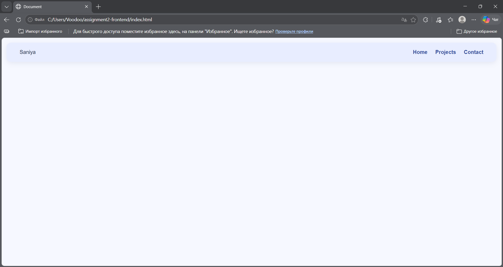
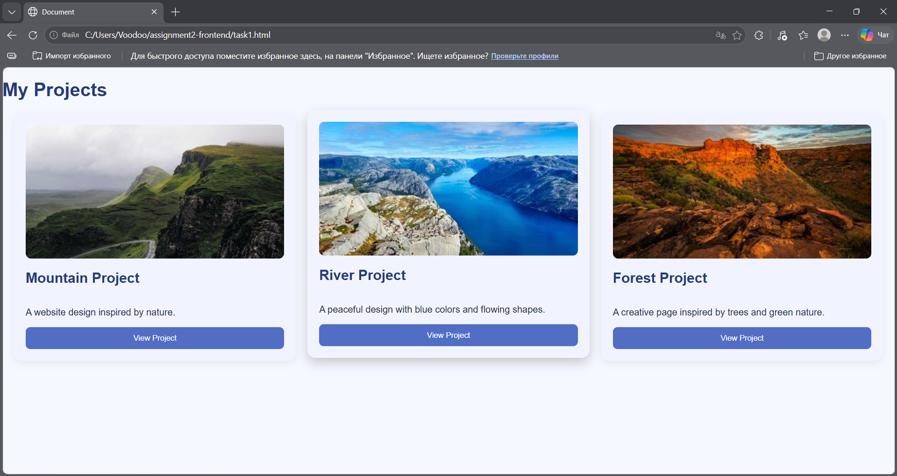
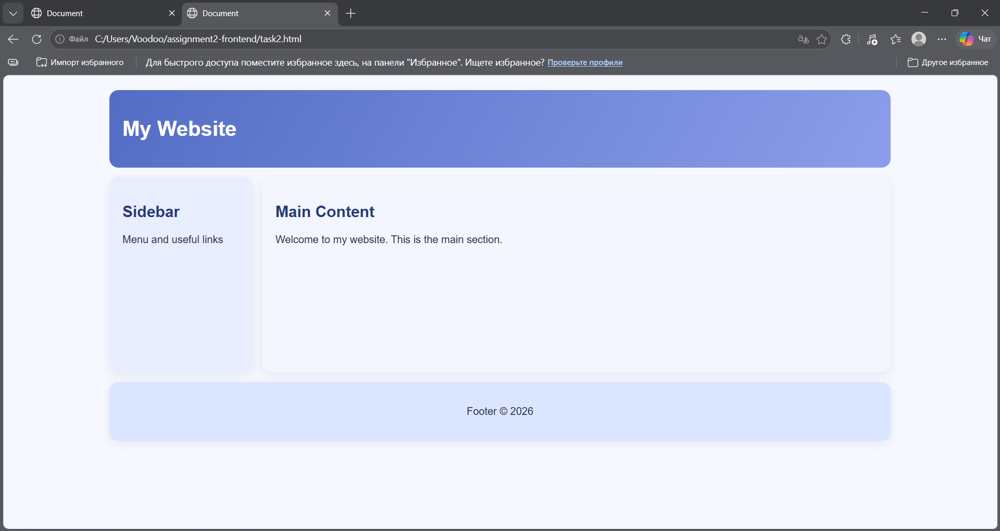
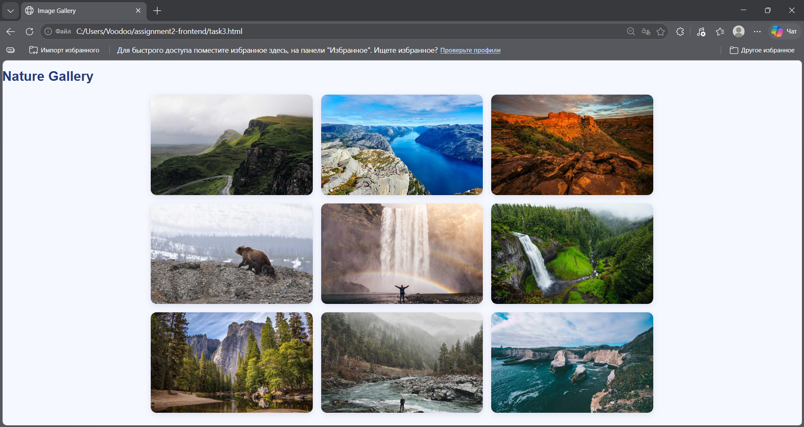
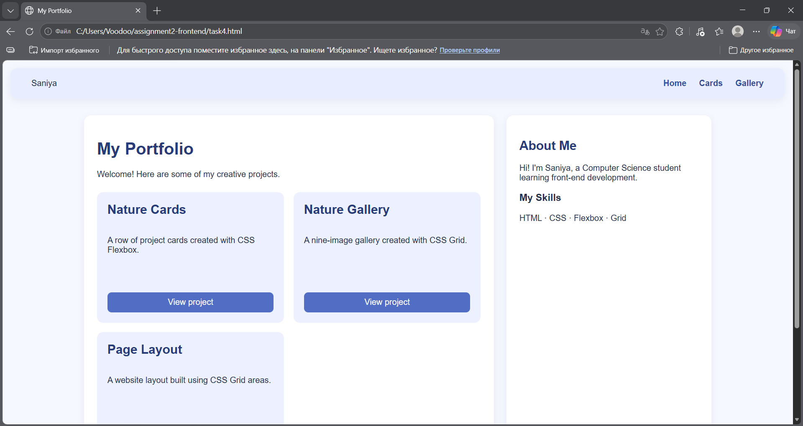

# Assignment 2 — Advanced CSS: Flexbox & Grid

**Name:** Zhumadilla Saniya  
**Group:** IT-2503

## Task 0 — Navigation Bar
I created a navigation bar with a logo on the left and links on the right. Flexbox aligns the elements horizontally and vertically.

## Task 1 — Card Row
I created three cards with images, titles, descriptions, and buttons. Flexbox places the cards in one row with equal heights, gaps, and a hover effect.

## Task 2 — Page Layout with Grid Areas
I used CSS Grid to place the header at the top, the sidebar on the left, the main content on the right, and the footer at the bottom.

## Task 3 — Image Gallery
I created a gallery of nine images using three equal-width Grid columns. A caption appears when the user hovers over an image.

## Task 4 — Portfolio Page
I combined Flexbox and Grid. Flexbox is used for the navigation bar and project cards; Grid places the projects on the left and the information sidebar on the right.

## Work Process
First, I created the HTML structure for each task. Then I added Flexbox for the navigation and cards, CSS Grid for the page layout and gallery, and combined both techniques on the portfolio page. Finally, I styled the pages and checked them in the browser.

## How to Run
Open `index.html` in a web browser. The other tasks can be opened through `task1.html`, `task2.html`, `task3.html`, and `task4.html`.